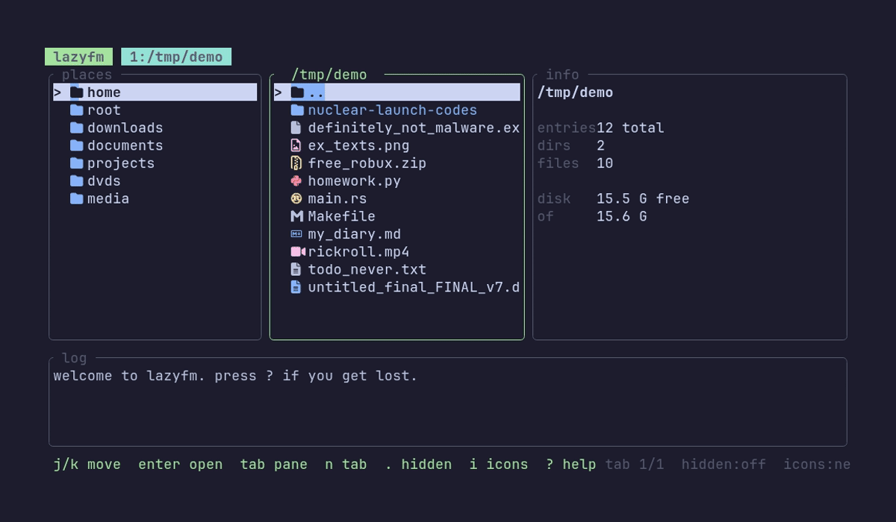

# lazyfm

a 20% cooler lazy tui file manager, with really pretty icons



## install

cargo install --git https://github.com/ZIZIES/lazyfm

## keys

| key | does |
|---|---|
| `j`/`k` | down/up |
| `h`/`l` | parent/enter |
| `g`/`G` | top/bottom |
| `n` / `w` | new/close tab |
| `.` | toggle hidden files |
| `i` | cycle icon theme |
| `?` | help |
| `[` / `]` | switch tabs

## fine text (DONT READ)

okay fine it was made with ai but thats only because im still learning rust.

deepseek 4.1 flash wrote most of it (cheap af). the icons were opus 5.5 after i asked like every other model and got desperate.

#rainbow dash approved
```rainbow dash approved
⠀⠀⠀⠀⠀⠀⠀⣀⣀⠀⠀⠀⠀⠀⠀⠀⠀⠀⠀⠀⠀⠀⠀⠀⠀⠀⠀⠀⠀⠀⠀⠀⠀⠀⠀⠀⠀⠀⠀⠀⠀⠀⠀⠀⠀⠀
⠀⠀⣠⣴⣾⡯⠍⠀⠀⠈⠉⠓⠢⣄⠀⠀⢀⣤⡀⠀⠀⠀⠀⠀⠀⠀⠀⠀⠀⠀⠀⠀⠀⠀⠀⠀⠀⠀⠀⠀⠀⠀⠀⠀⠀⠀
⠀⠈⢉⠔⠋⠀⠀⠀⠀⠀⠀⠀⠀⠀⠙⢶⠋⠀⠹⡄⠀⠀⠀⠀⠀⠀⠀⠀⠀⠀⠀⠀⠀⠀⠀⠀⠀⠀⠀⠀⠀⠀⠀⠀⠀⠀
⠀⣰⣣⡴⠉⠀⠀⠀⠀⠀⠀⠀⢀⣠⠴⠃⠀⢠⠀⣧⡀⠀⠀⠀⠀⠀⢀⣀⣄⠀⠀⠀⠀⠀⠀⠀⠀⠀⠀⠀⠀⠀⠀⠀⠀⠀
⢰⠟⢹⠁⠀⠀⠀⠀⣠⠄⣠⠞⠉⠀⠀⠀⠀⣸⠀⡏⢹⠀⠀⣠⢤⡴⠋⢀⡎⠀⣠⠴⠲⡆⠀⠀⠀⠀⠀⠀⠀⠀⠀⠀⠀⠀
⠀⢀⡇⠀⠀⢀⡴⠞⣿⢞⣵⣖⠓⠲⣎⣀⠔⠁⣠⣁⡎⡰⠋⢀⠎⠀⢀⣎⡴⠋⠀⢀⡼⠁⠀⠀⠀⠀⠀⠀⠀⠀⠀⠀⠀⠀
⢀⣼⣀⡤⣶⣩⡇⠐⣿⣿⠋⢻⣧⠀⠹⠷⠀⢰⡿⣿⠎⠀⢀⣞⣤⣤⡟⠋⠀⢀⡴⠋⠀⠀⠀⠀⠀⠀⠀⠀⠀⠀⠀⠀⠀⠀
⠈⠉⠀⠀⣿⣿⠁⠀⣿⣿⣧⣴⣿⠀⠀⠀⠀⡼⢀⡇⠀⢀⣾⠋⢀⠏⠀⢀⣴⣋⡀⢀⣠⡤⠤⠤⢤⣀⡀⠀⠀⠀⠀⠀⠀⠀
⠀⠀⠀⢰⡛⠁⠀⠀⠈⠿⣿⡿⠃⠀⠀⣠⠞⠁⣸⣷⢶⠋⣹⠀⣼⠖⢳⡎⠀⠀⠀⣀⠼⠛⠛⠳⣦⡀⠉⠳⣤⠀⠀⠀⠀⠀
⠀⠀⠀⠀⠳⣤⡊⠀⠀⠀⠀⠀⢀⡶⠟⢷⠆⣰⣿⣿⡜⣠⠇⠀⠁⢀⣞⡠⠔⠊⠉⠀⠀⠀⠀⠀⠈⠻⣟⢶⢬⣳⡀⠀⠀⠀
⠀⠀⠀⠀⠀⠀⠉⠉⠒⠒⠊⢉⡏⠀⢠⢏⣼⣿⡿⣿⠼⠟⠀⠀⠰⡏⠉⢙⡖⠢⢤⡀⠀⠀⠀⠀⠀⠀⢹⣆⢧⠙⢧⠀⠀⠀
⠀⠀⠀⠀⠀⠀⠀⠀⠀⠀⠀⢸⠀⠀⣿⣿⣿⣿⠃⡏⠀⠀⠀⣀⣠⣧⠖⡏⠀⠀⠀⠙⣆⠀⠀⠀⠀⠀⠀⣿⠘⡄⠀⠀⠀⠀
⠀⠀⠀⠀⠀⠀⠀⠀⠀⠀⠀⠸⡆⠀⣿⡟⢻⡇⢀⠇⠀⠀⠉⠁⠀⣿⠀⢳⠀⠀⠀⠀⠘⡄⢀⠀⠀⠀⠀⢹⡇⡇⠀⠀⠀⠀
⠀⠀⠀⠀⠀⠀⠀⠀⠀⠀⠀⠀⢳⡀⢿⠁⠸⡄⢸⠀⠀⠀⠀⠀⡐⠸⠀⡟⠀⠀⠀⠀⠀⣷⢸⠀⠀⠀⠀⢸⡇⢻⠀⠀⠀⠀
⠀⠀⠀⠀⠀⠀⠀⠀⠀⠀⠀⠀⠀⠳⢌⡀⠀⠹⣾⠀⡄⠀⢀⡴⠃⠀⢠⠃⠀⠀⠀⠀⠀⢸⣸⠀⠀⠀⠀⢸⡇⢸⠀⠀⠀⠀
⠀⠀⠀⠀⠀⠀⠀⠀⠀⠀⠀⠀⠀⠀⢸⠉⠓⢺⠈⠃⢹⣾⡉⠹⡀⠀⠸⠲⡀⠀⠀⠀⠀⣸⣿⠀⠀⠀⠀⢸⣿⡸⡇⠀⠀⠀
⠀⠀⠀⠀⠀⠀⠀⠀⠀⠀⠀⠀⠀⠀⢸⠀⠀⢸⠀⠀⠀⠇⢣⠀⢣⠀⠀⠀⢳⠀⠀⠀⠀⠋⢸⠀⡄⠀⠀⢸⣿⢿⣇⠀⠀⠀
⠀⠀⠀⠀⠀⠀⠀⠀⠀⠀⠀⠀⠀⠀⡆⠀⠀⢸⠀⠀⠀⢸⢸⠀⠸⡆⠀⠀⠈⡇⠀⠀⠀⠀⢸⡇⣿⡄⠀⢸⣿⡄⠻⡆⠀⠀
⠀⠀⠀⠀⠀⠀⠀⠀⠀⠀⠀⠀⠀⢠⠇⠀⠀⡎⠀⠀⠀⢸⣠⠀⠀⡇⠀⠀⠀⢹⠀⠀⠀⠀⠀⢷⣾⠙⣄⠘⣿⣷⡀⠀⠀⠀
⠀⠀⠀⠀⠀⠀⠀⠀⠀⠀⠀⠀⠀⡼⠀⠀⢀⡇⠀⠀⠀⢸⡿⠀⢠⠇⠀⠀⠀⢸⠀⠀⠀⠀⠀⠈⢻⡄⠈⠳⣿⡿⣿⣦⡀⠀
⠀⠀⠀⠀⠀⠀⠀⠀⠀⠀⠀⠀⡰⠁⠀⠀⣼⠀⠀⠀⠀⢸⠃⠀⡼⠀⠀⠀⠀⢸⠀⠀⠀⠀⠀⠀⠀⠁⠀⠀⠈⠙⠂⠉⠉⠉
⠀⠀⠀⠀⠀⠀⠀⠀⠀⠀⠀⠀⠓⠶⠶⢶⠃⠀⠀⠀⠀⣸⠋⢹⣃⡀⠀⢀⣀⡼⠀⠀⠀⠀⠀⠀⠀⠀⠀⠀⠀⠀⠀⠀⠀⠀
⠀⠀⠀⠀⠀⠀⠀⠀⠀⠀⠀⠀⠀⠀⠀⠈⠒⠒⠒⠒⠚⠁⠀⠀⠀⠀⠀⠀⠀⠀⠀⠀⠀⠀⠀⠀⠀⠀⠀⠀⠀⠀⠀⠀⠀⠀
```
